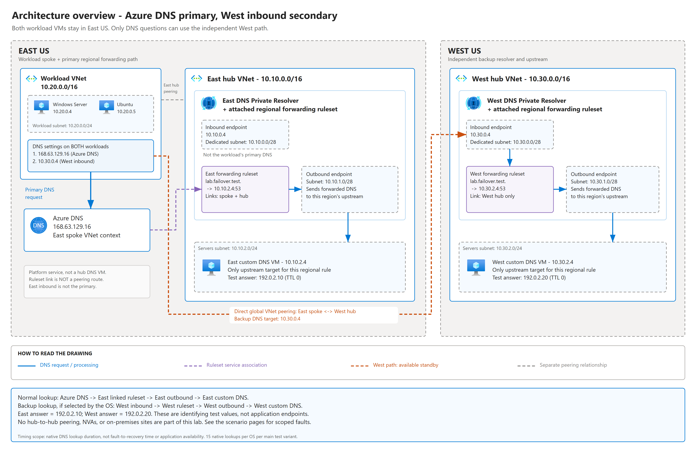
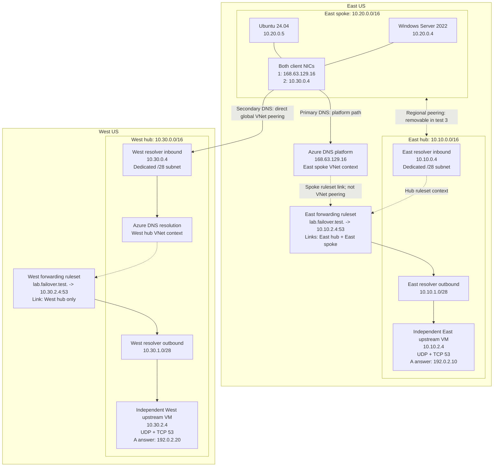
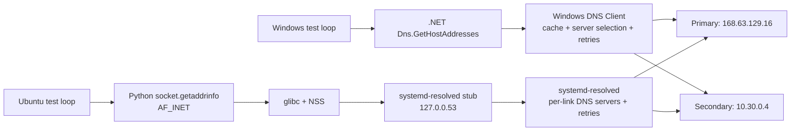
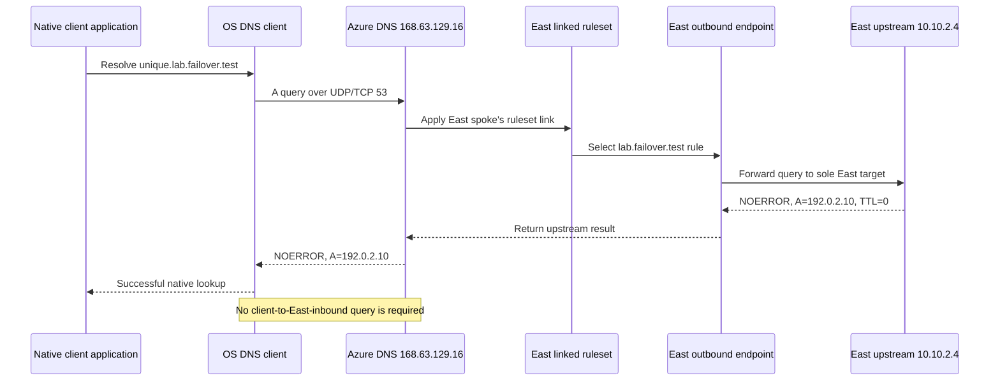
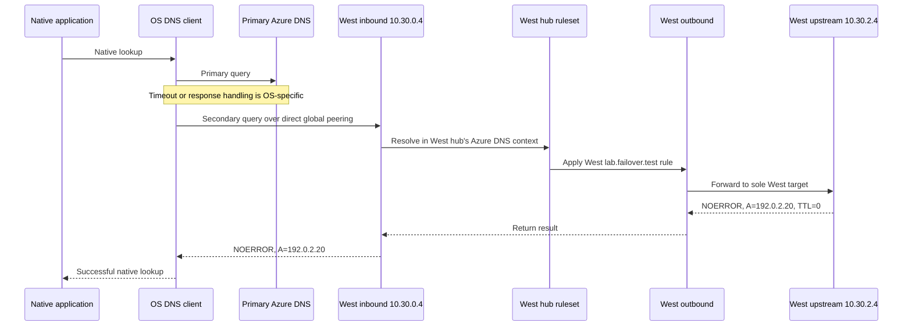
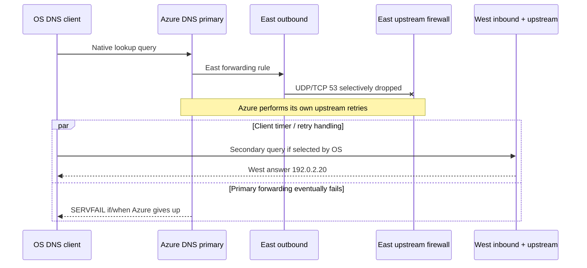
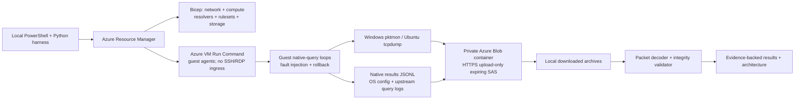

# End-to-end architecture and DNS flows



[Full-size SVG](./docs/diagrams/architecture-overview.svg) |
[Editable draw.io: overview and all three scenarios](./docs/diagrams/dns-failover-scenarios.drawio) |
[Drawing guide](./docs/diagrams/README.md)

For a first-time reader, start with [the plain-language scenario guide](./SCENARIOS.md).
It explains the normal lookup, each fault's exact location, the resulting path,
and the observed outcome separately for TC-01, TC-02 and TC-03. This document is
the more detailed reference for addresses, component relationships and sequences.

## 1. Deployment map

Subscription: selected by the person deploying; the original account ID is redacted.  
Default resource group: `rg-dns-crossregion-failover-poc`, overridable at deployment.



Solid arrows show DNS traffic or resolution processing. Dotted ruleset links
are Azure service associations, not IP routes. The peering line is a network
relationship, not an additional required hop on the primary service path.

### Address and resource inventory

| Component | Region | Address / subnet | Purpose |
|---|---|---|---|
| East spoke VNet | East US | `10.20.0.0/16` | Workload network |
| Client subnet | East US | `10.20.0.0/24` | Both client VMs |
| Windows client | East US | `10.20.0.4` | Native Windows DNS client |
| Ubuntu client | East US | `10.20.0.5` | libc/NSS/systemd-resolved DNS client |
| Azure DNS VIP | Platform | `168.63.129.16` | Primary, resolved in originating VNet context |
| East hub VNet | East US | `10.10.0.0/16` | East resolver and upstream |
| East inbound | East US | `10.10.0.4` in `10.10.0.0/28` | Deployed; not the normal workload primary |
| East outbound | East US | `10.10.1.0/28` | Delegated resolver subnet; no customer-managed fixed outbound IP |
| East upstream | East US | `10.10.2.4` in `10.10.2.0/24` | Lab authority, returns `192.0.2.10` |
| West hub VNet | West US | `10.30.0.0/16` | West resolver and upstream |
| West inbound | West US | `10.30.0.4` in `10.30.0.0/28` | Client secondary DNS address |
| West outbound | West US | `10.30.1.0/28` | Independent delegated resolver subnet |
| West upstream | West US | `10.30.2.4` in `10.30.2.0/24` | Lab authority, returns `192.0.2.20` |
| Private evidence container | East US | `example-evidence-storage/evidence` | Captures, query results and upstream logs |

Each resolver has separate delegated inbound and outbound subnets. Upstreams
and clients never share those delegated subnets.

### Network relationships

- East spoke <-> East hub: two directional peering resources.
- East spoke <-> West hub: two directional **global** peering resources.
- No East hub <-> West hub peering is required or created.
- No transitive peering assumption is made: the client has a direct West peer.
- East ruleset links both the East spoke and East hub.
- West ruleset links only West hub; it is not cross-region-linked to the spoke.
- There is one target per regional forwarding rule. The managed resolver cannot
  silently fail over from an East rule target to a second West rule target.
- There is no shared private DNS zone answering the test namespace. Every fresh
  test A answer must originate from one of the independent upstreams.

## 2. Native client call stacks



The test loops issue one native lookup at a time. They do not implement retries,
race the DNS addresses, or select a server themselves. Server changes, retry
spacing and errors are OS outcomes. Explicit `dig` / `Resolve-DnsName -Server`
calls run afterward and are labeled **direct diagnostics**, not failover proof.

Fresh random FQDNs and zero-TTL regional answers avoid positive-cache hits.
Windows can also issue AAAA queries; Ubuntu's measured native calls request IPv4.
The raw captures preserve both, while comparable wire summaries select A.

## 3. Healthy primary resolution



The East inbound endpoint is intentionally **not** the primary DNS IP. The
primary path enters Azure's platform DNS service directly from the spoke.
Forwarding still occurs through the linked East outbound endpoint.

## 4. Secondary / cross-region resolution



A West fingerprint in a native response, corroborated by a packet to West inbound
and a West upstream log entry, demonstrates the actual cross-region path. A
successful explicit query to West by itself does not.

## 5. Fault 1: primary Azure DNS timeout

Fault location: the **client guest firewall**.

```text
Native API -> OS resolver -> UDP/TCP 53 to 168.63.129.16 -> DROP
                          -> OS retry / selection timer
                          -> 10.30.0.4 over global peering
                          -> West ruleset -> West outbound -> West upstream
                          <- 192.0.2.20
```

- Drop both UDP and TCP destination port 53, not all traffic to Azure's VIP.
- Azure VM agent/platform traffic on other ports remains available.
- Three East-success lookups precede injection; fifteen calls run under fault.
- Capture queries, firewall state, fault application UTC and native latency.
- Restore firewall in `finally`; then issue three recovery calls.
- An eight-minute guest watchdog also removes the rules if the controller fails.
- Packets blocked before the NIC may not appear in the NIC capture. The firewall
  state, query delay and emitted West packets are therefore separate evidence.

## 6. Fault 2a: East forwarding-path drop, primary still reachable

Fault location: East upstream's firewall, restricted to resolver outbound source
subnet `10.10.1.0/28`.



This is not an outage of `168.63.129.16` itself. Unrelated Azure/public DNS
namespaces can remain resolvable. It is also not deletion of the outbound
endpoint or an Azure regional service outage: the deliberately narrow injection
breaks the East outbound-to-upstream DNS path.

**Ordering is decisive:** a SERVFAIL received after a West query does not prove
the SERVFAIL caused fallback. Packet timestamps establish whether primary
SERVFAIL preceded or followed the secondary request.

## 7. Fault 2b: reachable East upstream emits SERVFAIL

```text
OS -> Azure DNS -> East ruleset -> East outbound -> reachable East upstream
                                                   <- immediate upstream SERVFAIL
     Azure may retry upstream and delay its client-facing SERVFAIL.
OS -> West only if its own DNS stack selects / retries West.
```

The responder's mode is changed to `servfail`, not stopped. Its query log records
the native query name, source, RCODE 2 and UTC. That proves upstream negative
responses actually occurred. The client capture independently measures Azure's
client-facing negative response timing; these are not interchangeable timestamps.

### Additional fast-SERVFAIL control

```mermaid
sequenceDiagram
    participant OS as OS DNS client
    participant E as Controlled primary 10.10.2.4
    participant W as West secondary 10.30.0.4
    Note over OS,E: Temporary OS override; not Azure DNS primary
    OS->>E: Native query over East hub peering
    E-->>OS: Immediate SERVFAIL
    alt OS selects secondary
        OS->>W: Native secondary query
        W-->>OS: West A answer
    else OS returns a failure
        Note over OS: Record explicit native error; do not add an application retry
    end
    Note over OS,W: Restore [168.63.129.16, 10.30.0.4] in finally
```

This isolates native client policy for a fast negative response. It is a clearly
labeled control, not evidence that the real Azure service returns fast SERVFAIL.

## 8. Fault 3: remove East spoke/hub peering

```text
DELETE East spoke -> East hub peering
DELETE East hub -> East spoke peering

Still present:
  East spoke -> Azure DNS VIP -> linked East ruleset
                                   -> East outbound -> East upstream -> East answer
  East spoke <-> West hub global peering -> West inbound secondary

No longer directly reachable:
  East spoke -> East inbound 10.10.0.4 over the removed peering
```

The upstream is inside the East hub alongside its outbound endpoint. Removing
the spoke/hub peer therefore does not break outbound-to-upstream routing. The
spoke's ruleset link remains a service association and continues to route DNS
resolution through the ruleset without needing that peering.

The experiment checks:

1. ARM snapshots show East peering absent but West peering present.
2. The East ruleset's spoke link remains present.
3. Unique native lookups still return `192.0.2.10`.
4. Direct queries to East inbound time out after native testing.
5. Both directional East peerings are restored and checked.

Peering restoration runs in the controller's `finally`. Unlike guest firewall
faults, peering has no autonomous cloud rollback in this POC. Reapplying Bicep is
the recovery action if the controller is terminated during this phase.

## 9. Management, automation and evidence paths



- Bicep creates the resources and base NIC DNS configuration.
- Guest setup installs capture/DNS tools and the two independent responders.
- The controller first requires two fresh successful East primary probes.
- Native clients run concurrently on the two VMs; their query streams are serial.
- Upstream mode/firewall and peering changes have explicit restoration blocks.
- Each guest archives its evidence and uploads via HTTPS with a four-hour,
  create/write-only container SAS. The container is never made public.
- Local Azure credentials download evidence; upload credentials are not saved in
  source or the local manifest.
- Standard public IPs provide guest egress. NSGs deny Internet inbound access.
- The decoder correlates a native name with primary/secondary packets and the
  independent upstream log; the validator checks counts, uniqueness, capture
  decoding and upstream corroboration.
- Results are measured lookup delays and failures, not an assumed failover SLA.

## 10. What this architecture does not prove

- A real East US regional outage, managed resolver service outage, or both regions
  failing together.
- Automatic application reconnect, connection pool recovery or application RTO.
- All Windows, Linux, container, browser, JVM or custom DNS-library behavior.
- Instantaneous failback after the primary recovers.
- That a forwarding ruleset can be linked across regions.
- That a responding primary's arbitrary RCODE always makes every client switch.
- That successful independent primary/secondary probes prove client failover.

The actual measured outcomes and timing/order qualifications are in
[RESULTS.md](./RESULTS.md). Deployment and reproduction commands are in
[README.md](./README.md).
