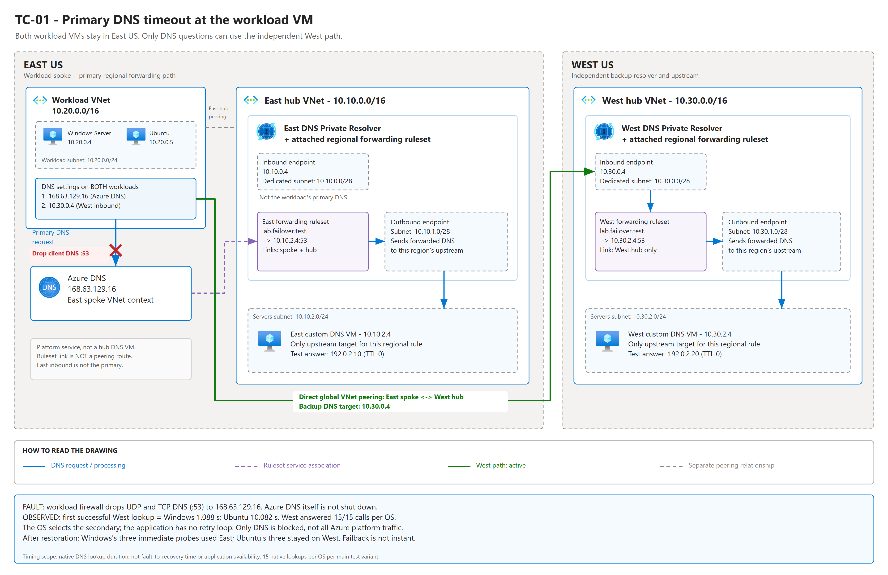
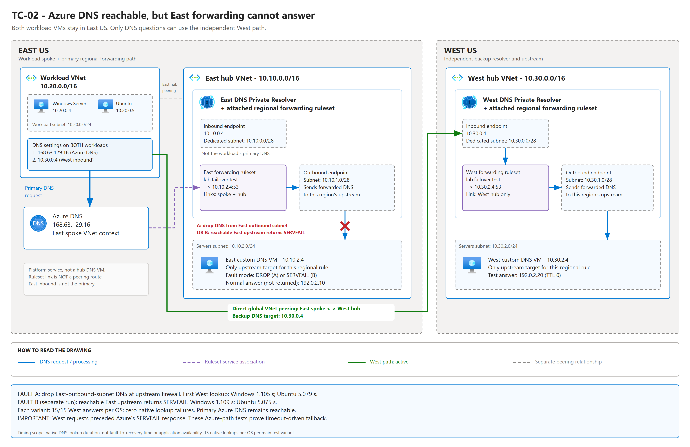
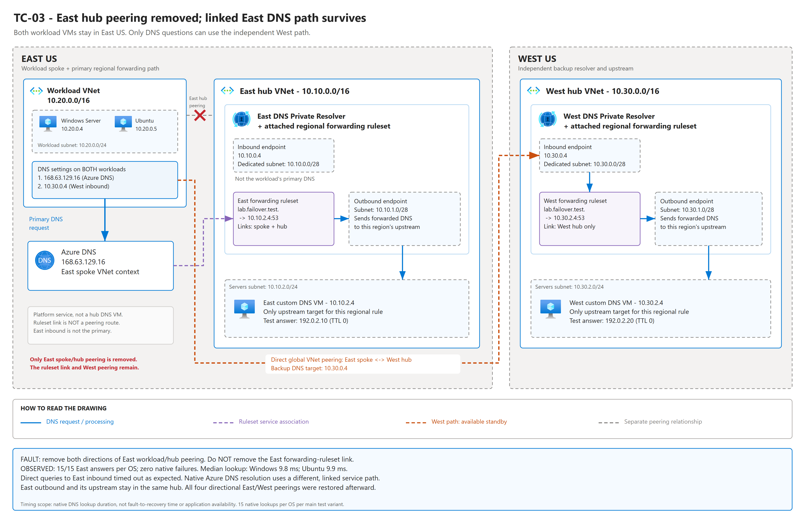

# What this lab tests: architecture, faults and results

**Start here if you have not worked on this lab.** You do not need to know
Azure DNS Private Resolver terminology to follow the three scenarios below.

## The question in ordinary language

An application knows a server's name, such as `orders.lab.failover.test`, but
needs an IP address before it can connect. **DNS** performs that name lookup.

The question is: **if the first DNS path cannot answer, will the computer
automatically ask its backup DNS server in another Azure region?**

We tested the computer's own DNS behavior on **Windows Server 2022** and
**Ubuntu 24.04**. We did not add retry logic to an application. We also tested
whether removing one network connection breaks Azure's linked DNS forwarding.

**The workload VMs never move to West US.** Only their DNS questions take the
backup West path when the client selects it.

This is a controlled lab, not a real Azure regional outage.

## What was built, and why each component exists

There are **four VMs**: two workload clients in East US, an East DNS upstream VM,
and an independent West DNS upstream VM. There are also **two Azure DNS Private
Resolvers**, one in each region. A managed resolver is not another VM.

| Component | Location / address | What it does in this experiment |
|---|---|---|
| Windows workload VM | East US, `10.20.0.4` | Acts as an application computer asking DNS questions |
| Ubuntu workload VM | East US, `10.20.0.5` | Asks the same kind of questions using Linux's own DNS stack |
| Primary DNS address on both workloads | `168.63.129.16` | Azure's platform DNS address; the starting point for normal East resolution |
| East forwarding ruleset | Linked to the East workload network and East hub | Tells Azure DNS to send questions ending in `lab.failover.test` to the East DNS upstream |
| East resolver outbound endpoint | East hub, subnet `10.10.1.0/28` | Sends those forwarded questions toward the East upstream |
| East upstream DNS VM | East hub, `10.10.2.4` | Produces the final test answer for the East path |
| Secondary DNS address on both workloads | West inbound endpoint, `10.30.0.4` | Receives backup questions sent directly by the workload's operating system |
| West forwarding ruleset and outbound endpoint | West hub; outbound subnet `10.30.1.0/28` | Process the backup question independently of East |
| West upstream DNS VM | West hub, `10.30.2.4` | Produces the final test answer for the West path |
| East resolver inbound endpoint | East hub, `10.10.0.4` | Deployed, but **not** used as the workload's normal primary; used for the direct diagnostic in TC-03 |

### Terms used below

- **Workload/client:** the Windows or Ubuntu VM requesting a name lookup.
- **Primary/secondary:** the configured first and backup DNS addresses. The OS
  still controls retries and server preference; this is not an application
  always querying both servers.
- **Upstream DNS:** the server that supplies the final answer after Azure
  forwards the question.
- **Forwarding ruleset:** a DNS instruction, not a network cable. Here the rule
  is: "send `lab.failover.test` questions to this region's upstream."
- **Inbound endpoint:** the address clients can send DNS questions to.
- **Outbound endpoint:** the managed component that sends forwarded questions
  to the upstream. It is not a second address configured on the workload VM.
- **VNet:** an Azure virtual network. The **spoke** contains the workloads; a
  **hub** contains a regional resolver and its upstream.
- **Peering:** a network connection between two VNets. The workloads have
  separate connections to the East hub and the West hub.
- **Timeout:** no answer arrives before a retry timer expires.
- **SERVFAIL:** a DNS response saying "the server could not complete this
  lookup." It is a response, not silence, and is not the same as "name not found."
- **Failover:** switching to a backup DNS path. **Failback:** returning to the
  original path after it recovers.

### The normal path and the backup path

Both workload VMs have this DNS configuration:

```text
First DNS address:   168.63.129.16  (Azure DNS)
Backup DNS address:  10.30.0.4      (West resolver inbound)
```

The normal lookup does **not** go to the East inbound endpoint:

```text
NORMAL EAST PATH
East workload VM
  -> Azure DNS 168.63.129.16
  -> East forwarding ruleset linked to the workload VNet
  -> East resolver outbound endpoint
  -> East upstream DNS 10.10.2.4
  <- East answer

BACKUP WEST PATH, IF THE CLIENT SELECTS IT
Same East workload VM
  -> direct East-spoke-to-West-hub global peering
  -> West resolver inbound endpoint 10.30.0.4
  -> DNS resolution using the West hub's forwarding ruleset
  -> West resolver outbound endpoint
  -> West upstream DNS 10.30.2.4
  <- West answer
```

`168.63.129.16` is an Azure platform address, not a DNS VM inside the East hub.
The workload's linked ruleset determines where its test questions are forwarded.
The West ruleset is linked to the West hub, **not** linked across regions to the
East workload network. The client reaches West by sending a DNS packet to the
West inbound endpoint over peering.

### How we know which path answered

The two upstreams answer the same test namespace, but deliberately return
different addresses:

| Answer received | Meaning |
|---|---|
| `192.0.2.10` | The East upstream supplied the answer |
| `192.0.2.20` | The West upstream supplied the answer |

These are **identifying test answers**, not real application endpoints. No
application connection to those addresses is attempted.

Each regional forwarding rule has **only one upstream target**. Therefore the
East rule cannot silently switch to a second West target. We verify client
fallback using the native answer, packets sent to West inbound, and the West
upstream's matching query log.

## TC-01: the workload cannot get a response from primary Azure DNS

### Question

**When the first DNS address goes silent, does the workload ask its backup in
West US, and how long does the lookup take?**

### Architecture during the fault

The normal East components remain deployed. The break is **on each workload VM**,
before its DNS packets can reach the Azure DNS address. The West path stays
connected and healthy.



[Full-size SVG](./docs/diagrams/tc-01-primary-timeout.svg) |
[Editable draw.io: select TC-01](./docs/diagrams/dns-failover-scenarios.drawio)

The Azure-style drawing above shows the deployed network boundaries and exact
fault location. The red cross marks blocked primary DNS traffic; the green
route is the successful backup question through West.

### What we did

1. Confirmed that three fresh lookups from each VM succeeded through East.
2. Added guest firewall rules dropping **UDP and TCP destination port 53** to
   `168.63.129.16`. Port 53 carries DNS traffic. Other Azure platform traffic was
   not blocked; Azure DNS itself was not shut down.
3. Asked each VM's native DNS stack to resolve 15 new test names.
4. Captured DNS packets and recorded successful answers, errors and lookup times.
5. Removed the firewall rules and ran three immediate recovery lookups per OS.

The scripts remove the fault in `finally`; an eight-minute guest watchdog also
provides rollback if the test controller is interrupted.

### Expected behavior and measured result

The target behavior was automatic client fallback to West without an application
retry loop. This is what happened on the two tested OS configurations:

| OS | Answers during fault | Failed native lookups | First faulted lookup completed in |
|---|---|---|---|
| Windows Server | West, 15/15 | 0/15 | **1.088 seconds** |
| Ubuntu | West, 15/15 | 0/15 | **10.082 seconds** |

**Meaning:** both clients used the backup, but a successful lookup could still
take ten seconds on Ubuntu. "No failed queries" does not mean instant recovery.

Packets dropped before the network-interface capture are not necessarily visible
in the capture. Firewall state plus the emitted West requests and West answers
establish what happened; we do not pretend to see every blocked retry.

After removing the fault, Windows's three immediate probes used East, while
Ubuntu's three used West. **Restoring primary reachability did not force immediate
failback on Ubuntu.** The later final recovery test explicitly reset DNS
configuration/preferences, so it is not a measurement of natural failback time.

## TC-02: Azure DNS is reachable, but its East forwarding path cannot answer

### Question

**Is a reachable primary enough to keep the workload stuck on a broken East
path, or does the workload use West? Does a DNS failure response change that?**

### Architecture during the fault

Unlike TC-01, the workload can send DNS questions to `168.63.129.16`. The fault is
farther along the **East outbound-to-upstream path**. West has its own resolver,
ruleset and upstream, so it does not depend on that broken East path.



[Full-size SVG](./docs/diagrams/tc-02-forwarding-failure.svg) |
[Editable draw.io: select TC-02](./docs/diagrams/dns-failover-scenarios.drawio)

The red cross marks the upstream fault, not a block at the client or Azure DNS.
The green route is the independent West path used by the clients.

There were **two separate variants**, not two faults applied together:

| Variant | Exact injection | What the primary experiences |
|---|---|---|
| **TC-02A: silent forwarding failure** | On the East upstream VM, drop UDP/TCP DNS arriving from the East outbound subnet `10.10.1.0/28` | Azure DNS can receive the client's question, but its forwarded question gets no upstream answer |
| **TC-02B: upstream SERVFAIL** | Keep the upstream reachable and make its DNS process return SERVFAIL | Azure receives upstream error responses, but may perform its own retries before answering the client |

The outbound endpoint was **not deleted**. Variant A simulates a selective
network failure at the upstream's firewall. This does not simulate every way a
managed outbound endpoint or Azure region could fail.

### What we did

1. Verified that Azure DNS could still obtain fresh East answers before injection.
2. Applied one of the two upstream faults above.
3. Left the workload's primary and secondary DNS addresses unchanged.
4. Ran 15 native lookups per OS and recorded answers, errors and retry packets.
5. Compared the time of the first West request with the time of Azure's
   client-facing SERVFAIL.
6. Restored the upstream mode/firewall before moving to the next case. Upstream
   faults also had an eight-minute rollback watchdog.

### Expected behavior and measured result

The target behavior was that the workload could still resolve names by selecting
West even though its configured primary remained reachable.

| Variant | Windows result | Ubuntu result | Failed native lookups |
|---|---|---|---|
| TC-02A: forwarding packets dropped | West 15/15; first lookup **1.105 s** | West 15/15; first lookup **5.079 s** | **0/15 per OS** |
| TC-02B: reachable upstream returns SERVFAIL | West 15/15; first lookup **1.109 s** | West 15/15; first lookup **5.075 s** | **0/15 per OS** |

**Meaning:** the clients did not get stuck waiting indefinitely on a reachable
but unsuccessful primary. They selected the independent West path.

### Why the SERVFAIL timing matters

These are different events:

1. The **East upstream** returns SERVFAIL to Azure's forwarding service.
2. **Azure DNS** eventually returns SERVFAIL to the workload.

They did not happen at the same time. The upstream failure did not immediately
become a client-facing failure response. In the real Azure path, both OSes had
**already sent a West request** before that response arrived.
Therefore TC-02 proves **timer-driven fallback during an unsuccessful primary
lookup**, not that Azure's SERVFAIL caused the switch.

To test fast failure-response handling separately, we added a clearly labeled
**control experiment**:

```text
Temporary DNS configuration for this control ONLY:
  Primary = East upstream 10.10.2.4, reached directly over East peering
  Backup  = West inbound 10.30.0.4

Workload -> controlled primary -> immediate SERVFAIL response
Workload -> West inbound -> West ruleset/outbound/upstream -> successful answer

Afterward restore primary = Azure DNS 168.63.129.16.
```

In that control, packets show SERVFAIL arriving **before** the West request.
Windows completed its first West-served lookup in **109.9 ms**, Ubuntu in
**86.3 ms**; each had 15/15 successful West answers. This establishes fast
SERVFAIL fallback for these tested clients, but it is **not** an Azure-primary
response-time measurement and is not mixed into TC-02A/TC-02B results.

## TC-03: remove the East workload-to-hub network peering

### Question

**Does the workload need a network peering to the East hub to use the DNS
forwarding ruleset linked to its VNet?**

### Architecture during the fault

We removed only the two directional peering resources connecting the East
workload network to the East hub. We did **not** remove the ruleset link.
The East outbound endpoint and East upstream remain together inside the East
hub, so their own network path is unchanged. West peering also remains present.



[Full-size SVG](./docs/diagrams/tc-03-peering-removal.svg) |
[Editable draw.io: select TC-03](./docs/diagrams/dns-failover-scenarios.drawio)

The red cross is only on the grey East peering relationship. The purple service
link and blue primary DNS path remain intact; the orange West path is available
but not needed for the measured native lookups.

### What we did

1. Confirmed East resolution was healthy.
2. Removed workload-to-East-hub peering and East-hub-to-workload peering.
3. Saved Azure configuration snapshots proving those peerings were absent,
   the West peering remained, and the East ruleset link still existed.
4. Asked each OS to resolve 15 new names using its native DNS stack.
5. After those native lookups, queried East inbound `10.10.0.4` directly as a
   separate network diagnostic.
6. Re-created both East peerings and verified all four East/West directional
   peerings were `Connected`.

### Expected behavior and measured result

The target was continued East resolution through the service link, without
needing client fallback to West.

| Check | Windows | Ubuntu |
|---|---|---|
| Native workload lookups through Azure DNS | **15/15 East answers; 0 failures** | **15/15 East answers; 0 failures** |
| Median native lookup time | **9.8 ms** | **9.9 ms** |
| Direct query to East inbound after removing peering | **Timed out**, error 1460 | **Timed out**, `dig` exit 9 |

**Meaning:** the workload did not need the removed peering to use its **linked
forwarding ruleset**. It did need a working route to query the **East inbound IP
directly**, which is why the separate direct diagnostic timed out.

The expected direct-diagnostic timeouts are not counted as failed native
workload queries. They demonstrate that the two DNS access methods are different.

This conclusion depends on the lab topology: the East outbound endpoint can
still reach its upstream inside the East hub. It does **not** mean forwarding
would survive losing whatever network path its upstream actually needs.

The controller restores peering in `finally`. There is no independent cloud
watchdog for peering removal in this POC; if the controller is terminated during
this case, reapply the Bicep deployment to restore the peerings.

## How to interpret the results without overclaiming

| Statement | Supported by this lab? |
|---|---|
| These Windows and Ubuntu clients used West when the primary DNS path could not answer | **Yes**, demonstrated by native answers, captured packets and matching upstream logs |
| Fallback was instant | **No**; the first Ubuntu lookup took about ten seconds in TC-01 |
| A reachable primary prevented all fallback | **No**; TC-02 still used West |
| Azure's SERVFAIL itself triggered fallback in TC-02 | **Not established**; West was tried before that response arrived |
| A fast SERVFAIL can be followed by a West query on these clients | **Yes**, shown by the separate direct-primary control |
| East ruleset resolution required the removed spoke/hub peering | **No**, not in this topology |
| DNS success proves the application reconnects or remains available | **No**; application connection recovery was not tested |
| Every OS, library, container or browser will behave identically | **No**; only the two recorded client stacks/configurations were tested |
| We simulated a complete East US outage | **No**; faults were deliberately scoped to DNS traffic or one peering relationship |

### What the timings and counts mean

- **ms** means milliseconds; **1,000 ms = 1 second**.
- Each main scenario/variant used 15 fresh native lookups **per OS**, issued one
  at a time with 500 ms between calls.
- "First lookup completed in 1.088 seconds" measures the native API call under
  fault. It is not an application recovery SLA or the time since an ARM change.
- The complete run includes baseline, the three requested cases and supplementary
  controls/recovery checks: **210 main-scenario lookups, zero failures**, plus
  12 successful native probes immediately before/after TC-01.
- A new random query name is used each time. Answers have **TTL 0**, meaning
  they should not be retained as positive cached answers. This prevents an old
  successful answer from masquerading as successful resolution during a fault.
- We did not merely use tools that force a specific DNS server. Windows used
  `.NET Dns.GetHostAddresses`; Ubuntu used `socket.getaddrinfo` through its
  libc/NSS/systemd-resolved path. The OS, not the test loop, chose the DNS server.
- Packet captures record request/response timing. Independent upstream logs and
  distinct East/West answer values corroborate which region served each name.
- Public captures contain only the lab DNS namespace; account identifiers are
  redacted. Full captures from your own run remain local and in your private
  Azure storage account.

## Where to go next

- [Three-case results table](./RESULTS.md#requested-test-cases-and-results):
  Test ID, Scenario, Description, Steps, Expected Result, Actual Result.
- [Detailed measurements and evidence](./RESULTS.md#evidence-index).
- [Technical architecture and complete address inventory](./ARCHITECTURE.md).
- [Deploy in your own subscription, run the tests and clean up](./README.md#deployment).

The reference is [Daniel Mauser's ruleset failover lab](https://github.com/dmauser/az-dnsruleset-failover).
Its central question is selection between upstream destinations inside a rule.
This lab instead isolates the **workload client's choice between two DNS server
addresses**, one starting the East path and one starting the West path.
